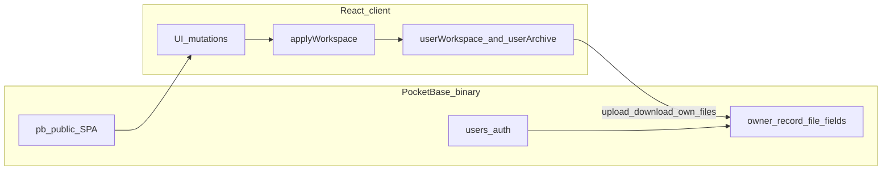

# PocketBase master plan

Roadmap for moving Project Binder from Electron + Node (`server.cjs`) to a **web-only** product on a thin PocketBase backend: **OSS self-host** and **paid cloud**.

This document locks architecture so later work does not re-litigate decisions. It is not an implementation of the spike.

## Product end state

- **Web only.** Long term there is no desktop / Electron app. Users either self-host or use the paid cloud.
- **OSS self-host:** one PocketBase process + `pb_data`; users bring their own VPS or optional Docker.
- **Paid cloud:** the same app artifact operated by the project maintainer; multi-tenant single PocketBase instance; billing (e.g. Stripe) around signup and limits later.
- **Desktop Electron + Node `server.cjs`:** transitional only. Keep shipping them until the web / PocketBase path reaches **HEAD feature parity**, then remove packager, `electron/`, and Node-as-product-server. Do **not** invest in a PocketBase-backed desktop rewrite.

Same codebase for self-host and cloud. Cloud differs by who runs the process and whether billing is enabled, not by a forked app.

## Non-regression (hard constraint)

**All functionality available at current HEAD must be kept without regressions** through the PocketBase / web transition and after desktop retirement.

“Thin PocketBase” means *where* logic and storage live, not cutting product surface. Required unless explicitly deprecated later:

- Task boards and master board
- Notes, files, databases
- Timelogs, trash, archive
- Export / import
- Attachments (card and tab files, RTE images)
- Demo / seed behavior and related developer restore flows (adapted to web where needed)
- Any other HEAD features

Phased delivery may land auth and storage first. A phase is **not done** for replacing Node / Electron until **feature parity with HEAD** is verified. No silent drops. Gate with a checklist against current HEAD.

## Architecture: PocketBase as thin as possible

PocketBase is a **dumb store + auth + static host**.

- **No** `pb_hooks`
- **No** custom Go / JS backend logic
- **No** port of `server.cjs` domain rules into the server
- **No** Node-in-front hybrid for the web build
- **No** long-lived backend beyond PocketBase itself

**All domain logic stays in the client** (UI mutations → in-memory workspace via `applyWorkspace` → persist files).

**Auth:** simple email / password. Each user may only create, read, update, and delete **their own** records (collection API rules such as `@request.auth.id = user`).

**Primary data = JSON files**, matching today’s names:

- `userWorkspace.json`
- `userArchive.json`

Stored as PocketBase **file fields** on an owner-scoped record. The client downloads, edits, and re-uploads. Do **not** store workspace / archive as JSON columns that the server interprets.

**SQLite / collections** only for auth and thin ownership metadata (and later relations if needed, e.g. billing customer id). Do **not** model boards, cards, or notes as PocketBase collections.

SMTP is optional later (verification / password reset only), not required for the thin core.

## Target schema (not implemented in this doc pass)

- `users` — email / password auth collection.
- One owner-scoped collection (e.g. `user_data`):
  - `user` (relation, unique)
  - file field for workspace (`userWorkspace`)
  - file field for archive (`userArchive`)
  - API rules: owner-only CRUD
- Later: attachment uploads as additional file fields or a simple owner-scoped files collection; still no hooks.

## Local run (hard constraint)

**Every build must be testable locally by simply running the PocketBase binary**, e.g. `./pocketbase serve`, after a documented one-time setup:

1. Obtain the PocketBase binary for the platform
2. Build the UI into `pb_public`
3. Ensure migrations (when they exist) sit beside the binary

No mandatory cloud account, Docker, or multi-service stack just to try the app. Docker Compose may exist for self-host convenience; the **binary path is the primary local / self-host loop**. Cloud is that same artifact operated remotely.

Backup for self-host / local: the `pb_data` directory (database + stored files).

## Phased roadmap

### 1. Spike

- Serve built UI from `pb_public`
- Email / password auth
- Load / save `userWorkspace` and `userArchive` as files
- No hooks
- Seed empty or demo JSON files for new users

### 2. Parity gaps

Restore every HEAD capability on the web / PocketBase path:

- Card / tab uploads, archive, export / import, trash, timelogs, DB tabs, notes, master board, etc.
- Replace anything that still assumes Node disk paths

**Gate:** checklist vs current HEAD; no regressions.

### 3. Self-host packaging

- `pb_migrations` for collections and API rules
- Short README with `./pocketbase serve` first
- Backup = `pb_data`
- Docker Compose optional, not required for local test

### 4. Cloud

- Deploy the same image / binary layout
- Public signup
- Stripe (or equivalent); `CLOUD` (or similar) env for billing-only bits
- Keep core MIT; billing layer stays thin and optional for self-host

### 5. Retire desktop

Only after web / PocketBase matches the HEAD feature set:

- Drop Electron packaging, `electron/`, and Node as the product server
- Update README / AGENTS to web-only
- Document migration for existing desktop users (export zip → import into web / self-host)

## Explicit non-goals

- `pb_hooks`, custom PocketBase backend logic, or server-side validation of workspace shape
- Workspace / archive as server-interpreted JSON **columns** (files first; DB only for ownership / relations)
- Normalizing boards / cards into many PocketBase collections
- Long-term desktop or Electron + PocketBase hybrid
- Self-hosted Supabase / Appwrite as the backend
- Keeping `server.cjs` as the web backend once PocketBase lands

## Relation to current codebase

Today (HEAD): React UI + `src/api.js` → Node `server.cjs` → `userWorkspace.json` / `userArchive.json` / uploads (Electron on disk; CLI / browser often in-memory).

Target: React UI + thin client storage adapter → PocketBase auth + owner file fields; domain logic remains client-side. Fine-grained `/api/*` routes are not ported server-side; persistence becomes “save these JSON files (and later attachment files) for the logged-in user.”

## Doc status

- **This file:** architecture and roadmap only (branch `build/pocketbase`).
- **Not in this pass:** PocketBase binary in repo, migrations, auth UI, client adapter, or changes to `server.cjs`.
